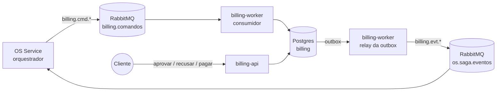

# oficina-billing-service

Orçamento e pagamento da oficina mecânica — Tech Challenge 13SOAT, Fase 4.

Participa da **Saga orquestrada** pelo [OS Service](https://github.com/Lorenalgm/oficina_mecanica): recebe comandos, executa a parte de cobrança e responde com eventos. Não acessa o banco de nenhum outro serviço; tudo o que precisa chega no payload das mensagens ([contrato](https://github.com/Lorenalgm/oficina_mecanica/blob/main/docs/fase4/contrato-mensagens.md)).

[](https://sonarcloud.io/summary/new_code?id=Lorenalgm_oficina-billing-service)
[](https://sonarcloud.io/summary/new_code?id=Lorenalgm_oficina-billing-service)

## Arquitetura



- Hexagonal: `src/Domain` (orçamento, pagamento, envelope), `src/Application` (handlers e casos de uso), `src/Infrastructure` (Eloquent, RabbitMQ, gateway).
- **Outbox transacional**: o evento é gravado na mesma transação da mudança e publicado depois, com *publisher confirms*.
- **Consumo idempotente**: o `message_id` é registrado junto com o efeito; mensagem repetida não repete o efeito. Erro técnico: 3 tentativas e depois DLQ.
- **Banco próprio**: Postgres 16 em StatefulSet no cluster, declarado em `k8s/postgres.yaml`.

## Mensagens

| Recebe (comando) | Responde (evento) |
|---|---|
| `billing.cmd.gerar-orcamento` | `billing.evt.orcamento-gerado` (com o link de aprovação) ou `billing.evt.orcamento-falhou` |
| `billing.cmd.cancelar-orcamento` | `billing.evt.orcamento-cancelado` |
| `billing.cmd.cobrar` | `billing.evt.cobranca-criada` (com o link de pagamento) |
| `billing.cmd.estornar` | `billing.evt.pagamento-estornado` ou `billing.evt.estorno-falhou` |

Publicados a partir da ação do cliente: `billing.evt.orcamento-aprovado`, `billing.evt.orcamento-recusado`, `billing.evt.pagamento-confirmado`, `billing.evt.pagamento-recusado`.

## Rotas

Documentadas no [readme.io](https://lorenalgm.readme.io/reference) (junto com as do OS e da Execução) e em [`openapi.yaml`](openapi.yaml). Não exigem login: o link enviado ao cliente vai direto ao load balancer e usa o token do orçamento. Pelo API Gateway, como toda rota `/api/*`, pedem o JWT.

| Rota | Uso |
|---|---|
| `GET /api/orcamentos/{id}?token=` | Cliente vê o orçamento (link do e-mail) |
| `POST /api/orcamentos/{id}/aprovar` | Cliente aprova (`token` no corpo) |
| `POST /api/orcamentos/{id}/recusar` | Cliente recusa |
| `POST /api/pagamentos/{id}/simular` | Simula o retorno do Mercado Pago (`resultado: aprovado\|recusado`) |

## Mercado Pago

O pagamento passa pela porta `GatewayPagamento` (criar cobrança e estornar). Nesta entrega o adaptador é um **mock do Mercado Pago** (`FakeGateway`): gera o link de pagamento, e a rota `/simular` faz o papel do webhook de retorno. A escolha foi deliberada para a demonstração não depender de conta e credenciais de sandbox; um adaptador real implementa a mesma porta sem mudar handlers nem testes. `PAYMENT_FAKE_FALHAR_ESTORNO=true` faz o estorno falhar, para demonstrar a Saga em `compensacao_falhou`.

## Rodar localmente

```bash
cp .env.example .env && php artisan key:generate
docker compose up -d           # API em http://localhost:8001 e Postgres
php artisan test               # testes (SQLite em memória)
```

Os testes de integração com RabbitMQ rodam quando `RABBITMQ_TEST_HOST` está definido (no CI, um RabbitMQ sobe como service).

## Kubernetes e CI/CD

- `kubectl apply -k k8s/` depois de criar o Secret `billing-secrets` (`k8s/secret.example.yaml`). Depende da plataforma do [oficina-infra-k8s](https://github.com/Lorenalgm/oficina-infra-k8s) (RabbitMQ e `plataforma-secrets`).
- **CI** (PR): testes com cobertura mínima de 80%, SonarCloud e build da imagem. `main` só recebe código por PR com o CI verde.
- **CD** (`main`): testes → imagem no GHCR → deploy no EKS (migração, rollout e smoke test).
